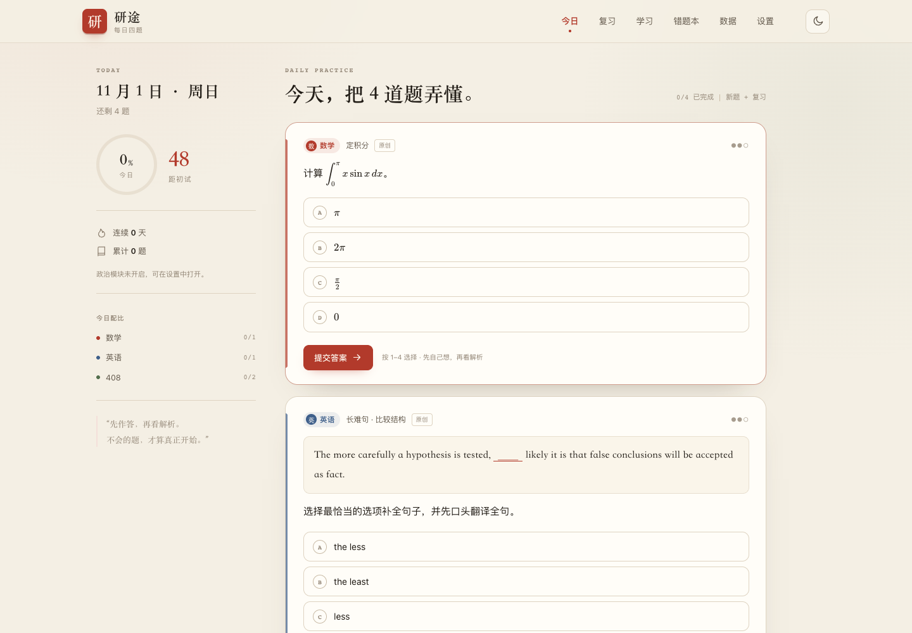
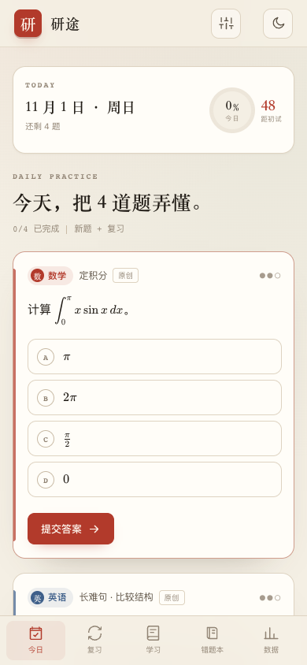
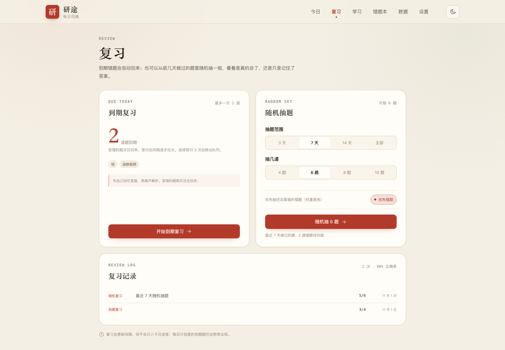
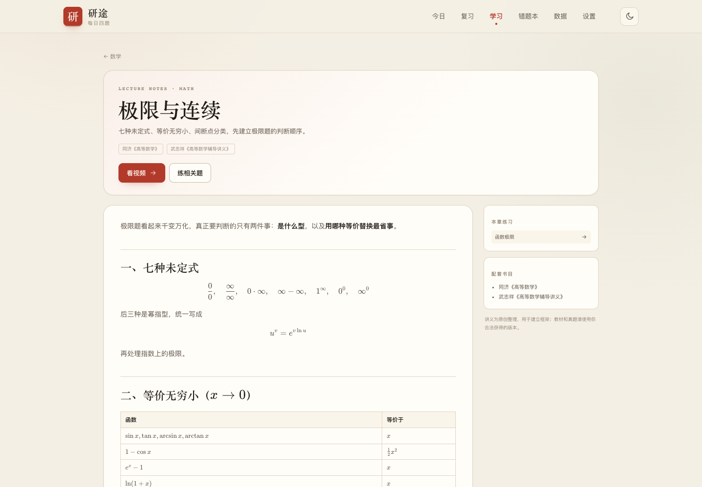

# 研途 · 每日四题

[](https://github.com/ipoger/kaoyan-daily/actions/workflows/deploy.yml)

> 每天一道数学题、一句英语长难句、两道 408。先作答，再看解析；答错的题自动进入错题本，到期再考你一次。

一个纯静态、不登录、不收费、不上传数据的考研每日练习工具。部署在 GitHub Pages 上，打开网页就能用；进度保存在浏览器本地，也可以导出成 JSON 备份。

[在线使用](https://ipoger.github.io/kaoyan-daily/) · [功能](#功能) · [快速开始](#快速开始) · [部署](#部署到-github-pages) · [题库格式](#题库与导入) · [设计说明](#一些设计说明)



<p align="center"></p>

| 学习页 | 复习页 |
| --- | --- |
|  |  |



## 功能

- **固定节奏，不替你安排太多。** 默认每天数学 1 题、英语 1 句、408 两题；题量可调，政治默认关闭。
- **先作答，再公布解析。** 选择题和填空题自动判分，数学公式用 KaTeX 渲染；英语长难句在提交后才展示完整句子、参考译文、语法点和词汇。
- **错题自动回流。** 答错次日复习；答对后按 3 / 7 / 15 / 30 / 60 天逐步拉长间隔；连续答对 3 次自动移出每日复习队列。
- **学习页有讲义，不只有题。** 每科按章节提供原创讲义（公式、题型、易错点）、B 站视频搜索入口、配套书目和知识点专项练习。
- **题源可标注、可优先。** 每道题显示「真题 / 模拟题 / 教材 / 原创」；导入自己合法获得的真题或模拟题后，每日新题会优先安排，随机复习也会加权。
- **复习页支持两种复习。** 一种是今天到期的错题；另一种是从前 3 / 7 / 14 天（或全部之前）做过的题里随机抽一组，可设置题量、优先抽错题。
- **错题本可以单独重练。** 不占用今日进度，但会更新复习间隔。
- **数据看得见。** 首答正确率、科目掌握度、最近 12 周热力图、薄弱知识点。
- **本地优先。** 没有账号和后端；进度存在 `localStorage`，可导出 / 导入 JSON，换设备时手动迁移。
- **可离线。** 生产构建带一个简单的 service worker，首次打开后断网也能继续做题。
- **键盘可用。** 数字键 `1–4` 选择，`Enter` 提交 / 下一题。
- **自带 24 天 starter 题库。** 数学 24 题、英语 24 句、408 48 题、政治 12 题，共 108 道原创题；刷完后可以导入自己的题库，或继续按最久未做的顺序循环。

## 快速开始

需要 Node.js 20.19+ 或 22.12+（Vite 8 的要求）。

```bash
npm ci
npm run dev       # http://localhost:5173
npm run build     # 产出 dist/
npm test          # 29 个单元测试
npm run validate  # 只校验 content/ 下的题库
```

### 部署到 GitHub Pages

1. Fork 或导入这个仓库。
2. 在仓库 **Settings → Pages → Build and deployment** 中，把 Source 设为 **GitHub Actions**。
3. push 到 `main`。`.github/workflows/deploy.yml` 会自动测试、构建并部署。
4. 打开 `https://<你的用户名>.github.io/<仓库名>/`。

工作流会把 `BASE_PATH` 设成 `/<仓库名>/`，所以仓库改名也能正常工作。如果绑定自定义域名，需要把 `BASE_PATH` 改成 `/`，或在 `vite.config.js` 里调整。

## 每天是怎么排的

1. 先放入到期的复习题，最多 `reviewLimit` 道（默认 4）。
2. 再按设置里的每日题量，从没做过的题里抽取新题。
3. 新题不够时，用最久没做的旧题补位。
4. 用日期作为随机种子：同一天刷新页面，题目不会跳来跳去；计划本身也会存进本地，避免中途改设置打乱已经开始的练习。

“今日完成”指计划里的题全部作答，而不是只看对错。复习题同样计入进度。

复习页的随机抽题和专项练习是“额外加练”：会更新每道题的间隔复习状态，也记入复习记录，但不会改变今日计划的完成度。随机抽题只取今天之前的作答，避免刚做完就立刻重做同一道题。

如果设置里开启“优先练习已标注题源的题”，每日新题会先抽真题 / 模拟题 / 教材题，再补原创题；复习抽题也会给这些题更高权重。

## 讲义、视频与题源

学习页的「讲义」是仓库内的 Markdown 原文，位于 `content/materials/`，可以按自己的笔记习惯直接改。每章包含：

- 原创讲义：概念、公式、常见题型和易错点；
- 视频入口：跳到 B 站搜索，不搬运视频；
- 配套书目：只列书名，不提供电子书；
- 相关习题：按知识点进入专项练习。

**关于真题、模拟题和教材题。** 这个仓库不直接收录受版权保护的教材原文、模拟卷或历年真题全文。内置 108 道题全部标注为「原创」，不会伪装成真题。你可以把自己合法获得的题目整理成 JSON 导入，并填写：

```json
"source": { "type": "真题", "name": "2024 考研数学一", "detail": "第 3 题" }
```

`type` 可选：`真题` / `模拟题` / `教材` / `原创` / `其他`。导入后，题目卡片会显示题源，设置页会统计题源分布，每日和复习会优先安排有题源的题。这样既能用真题训练，又不把受版权保护的内容直接放进公开仓库。

## 题库与导入

内置题库在 `content/`：

| 文件 | 科目 | 数量 |
| --- | --- | --- |
| `content/math.js` | 数学一 | 24 |
| `content/english.js` | 英语一 | 24 |
| `content/cs408.js` | 408 | 48 |
| `content/politics.js` | 政治 | 12（默认关闭） |

题目全部为原创或按公开知识点重新表述，**不直接收录历年真题原文**。如果你要练真题，请使用自己合法获得的资料，整理成 JSON 后在「设置 → 导入题库」中导入。

字段说明和格式示例见 [`content/README.md`](content/README.md) 与 [`examples/questions.sample.json`](examples/questions.sample.json)。

## 数据与隐私

- 作答记录、错题、设置和自定义题库只写入当前浏览器的 `localStorage`。
- 没有网络请求、没有统计脚本、没有账号体系。
- 换浏览器、清理站点数据或换设备前，请在「设置 → 导出备份」保存 JSON。
- 导入备份会覆盖当前进度。

## 目录结构

```text
.
├── content/                # 题库（JS 模块）与 materials/ 讲义（Markdown）
├── docs/                   # README 截图
├── examples/               # 可导入的题库示例
├── public/                 # PWA 图标、manifest、service worker
├── scripts/
│   └── validate-content.mjs
├── src/
│   ├── lib/                # 日期、判分、排期、复习抽题、学习统计、存储
│   ├── ui/                 # 视图、图标、富文本/公式渲染
│   ├── main.js             # 状态、事件、路由
│   └── styles.css
├── tests/                  # Vitest 单元测试
├── .github/workflows/      # CI + GitHub Pages 部署
├── index.html
└── vite.config.js
```

## 一些设计说明

**为什么不做后端。** 每日练习的核心是“打开就能做”，而不是注册、同步和订阅。静态站点在 GitHub Pages 上免费、快、可离线，也避免了把学习数据交给第三方。代价是跨设备需要手动导出 / 导入，这个取舍写在设置页里。

**为什么题库以原创题起步。** 真题的版权和传播边界比较复杂，直接打包进开源仓库并不合适。starter 题库负责把系统跑起来；真正的真题训练，交给用户自己合法获得的资料。

**为什么有“首答正确率”。** 重做同一道题会把普通正确率拉高，首答正确率更接近“第一次遇到它时会不会”。数据页用它来看科目掌握度，用全部作答次数看练习量。

**视觉。** 纸白、墨色、朱砂印章，标题用宋体，正文用系统无衬线；没有插画和渐变堆叠，尽量像一个可以每天打开的书桌。

## 已知限制

- 填空判分只做字符串归一化和数值容差，不做符号等价判断；需要复杂表达式时请用选择题。
- 政治题库只覆盖稳定基础概念，不含时政；正式备考请以当年大纲和权威资料为准。
- 跨设备同步需要手动备份；浏览器隐私模式下数据可能不持久。
- 题库更新后，已经生成的当天计划不会自动改变（除非当天还没有作答）。
- 随机复习依赖“今天之前”的作答记录；第一天使用时抽题范围为空，先完成当天的题即可。
- 内置题没有使用真实真题原文；要刷真题/模拟题，需要自己导入并标注题源。
- 视频是搜索入口，具体课程以 B 站 UP 主和教材版本为准。
- 学习页的知识点状态按首答正确率计算；只做过一次且答错的题会直接标为“薄弱”，这是有意的偏保守处理。

## License

代码与原创题目均以 [MIT](LICENSE) 发布。第三方依赖（KaTeX、Vite）遵循各自许可证。

本项目与任何考试机构、出版社、课程平台无关。题目和解析仅供个人学习参考，发现有误欢迎提 Issue 或 PR。
